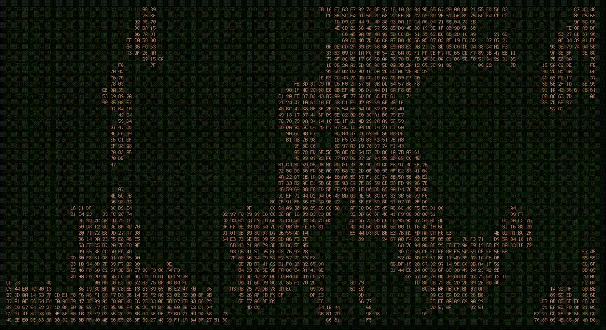

# Hextrix

**v1.0.0 — Stationary data, living color.**



Hextrix fills your terminal with a dense grid of two-character hexadecimal
tokens, like a frozen memory dump. The characters never move — only their
colors do. Slow, organic regions of color flow through the grid like liquid,
merging, stretching and dissipating, while individual token pairs flicker to
new random values.

## Features

- **Fixed grid** — tokens are laid out once from the terminal size and stay
  in place; resizing reflows only what is needed, nothing ever scrolls.
- **Two foreground states** — body text is drawn in deep gray (terminal
  color 8) further dimmed with `A_DIM`, so it recedes hard; the liquid
  regions use a **bold accent color** (default red) that pops against it.
  No gradients, RGB palettes or glow; the background is always your
  terminal's default background.
- **Ambient liquid** — a domain-warped noise field advected by a curl
  (divergence-free) flow produces amoeba-like shapes with tendrils that
  stretch, curve, merge and split.
- **Token flicker** — any token pair can randomly change to a new value; the
  rate is user controlled (and can be frozen).
- **Audio reactive** — system output is captured through PipeWire and reduced
  to bass / mid / treble energies that push waves, swirls and ripples into
  the same color field. It is not an equalizer: the characters never move.
- **Cheap** — ~14 % of one CPU core at 60 FPS on a 200×50 terminal, with
  monotonic frame pacing, per-cell dirty tracking and no per-frame
  allocations.

## Build

Arch Linux (Omarchy/Hyprland included):

```bash
sudo pacman -S --needed base-devel ncurses
make
./hextrix
```

To put it on your `PATH` (installed to `~/.local/bin`, already on PATH on
Omarchy):

```bash
make install        # copies to ~/.local/bin/hextrix
hextrix
```

PipeWire headers are optional and detected automatically:

```bash
sudo pacman -S --needed pipewire   # only needed for audio reactivity
make clean && make
```

No root privileges are required to compile. The only hard dependency is
`ncursesw` (plus a C11 compiler); `libpipewire` is linked in only when
`pkg-config` finds it.

### Options

```text
-a, --alnum      alphanumeric tokens instead of hexadecimal
-n, --no-audio   do not capture system audio
-f, --fps N      target frame rate, 10..120 (default 60)
-h, --help       show usage
-V, --version    show version
```

### Keys

| Key | Action |
| --- | --- |
| `q` / `Ctrl+C` | quit cleanly (restores the terminal) |
| `space` | pause / resume everything |
| `r` | reset the fluid field without touching the grid |
| `m` | enable / disable audio reactivity |
| `+` / `-` | animation intensity (more / less red) |
| `↑` / `↓` | token change speed (`↓` freezes the hexdump, `↑` resumes) |
| `←` / `→` | fluid speed: slow it down (to 0.15×) / speed it up (to 4×) |
| `v` | cycle visualizer: wave → rain → off (liquid, default); the name flashes |
| `1`–`9` | accent color of the liquid (see below) |
| `h` / `?` | toggle a temporary help overlay (auto-hides after ~9 s) |
| `Esc` | close the help overlay |

Switching hints (visualizer, accent, speed) flash briefly in the middle of
the screen on a dim plate so they stay readable over the tokens. The display
is immersive by default: no borders, offsets, status bars or overlays.

## Accent colors

The liquid regions are drawn in one accent color at a time. Press `1`–`9`
to switch; the name flashes on screen and the whole field repaints
immediately:

| Key | Color | Key | Color |
| --- | --- | --- | --- |
| `1` | red (default) | `6` | cyan |
| `2` | green | `7` | white |
| `3` | yellow | `8` | bright red |
| `4` | blue | `9` | bright magenta |
| `5` | magenta | | |

## Visualizer styles

By default the visualizer is **off**: you get the ambient **liquid** — an
organic field of color blobs drifting through the whole grid, energized by
the music. Press `v` to opt into a visualizer style; pressing it past the
last style turns it back off:

| Mode | Look |
| --- | --- |
| `liquid` (default) | organic noise-gated blobs drifting with the curl flow |
| `wave` | a smooth cava-style swell rolling along the bottom edge |
| `rain` | vertical streaks born at the top, falling down |

In `wave`, the crest line lifts with the music (bass/mids) and settles when
it goes quiet; trebles add foam-like sparkle at the surface. In `rain`,
bass and mids speed the fall. All modes breathe on their own without audio.

## Audio

Hextrix opens a PipeWire capture stream against the highest-priority
`Audio/Sink` node using `stream.capture.sink=true`, i.e. it listens to the
sink *monitor* (everything the machine is playing). The signal is filtered
with three IIR bands (bass ≈ 130 Hz low-pass, mid ≈ 900 Hz band-pass,
treble ≈ 4.2 kHz high-pass), RMS-normalized and smoothed before it touches
the fluid:

- bass drives broad, powerful waves,
- mid drives swirling and deformation of the flow,
- treble creates fine ripples,
- silence gradually returns the field to its idle behavior.

### Audio limitations (honest notes)

- Audio support is compiled in only when `libpipewire-0.3` is present at
  build time; otherwise the binary builds fine and `audio_backend` reports
  `none`.
- If no sink exists, PipeWire is not running, or the stream cannot connect,
  Hextrix keeps running with the ambient animation (`m` toggles the attempt).
- The stream requests F32 mono at 48 kHz; PipeWire normally converts. On
  exotic rates the link may fail — the animation still works.
- It captures system output only, not individual application streams, and it
  does no MPRIS/metadata work.
- Band analysis uses IIR filters, not an FFT, to stay dependency-free.

## Environment

- `HEXTRIX_LOG=/path/to/file` writes a diagnostic log (startup info, grid
  size, FPS, red coverage, audio state and band energies every two seconds).

## Notes on the visual model

1. A time-evolving value-noise field is domain-warped to produce the ambient
   liquid pattern; its gradient is thresholded into the two color states with
   hysteresis, so boundaries move smoothly instead of flickering.
2. A second noise field provides the velocity potential; its curl advects a
   dye field (semi-Lagrangian sampling) so disturbances travel coherently
   through neighbouring cells.
3. Audio injects noise-gated dye into the same field — the animation and the
   audio response are one simulation, not two layers.

Pointer/mouse tracking is not enabled in this build.

## Project layout

```text
hextrix/
├── Makefile
├── README.md
├── assets/
│   └── demo.gif       screen recording of the app in a real terminal
├── src/
│   ├── main.c        startup, frame loop, terminal lifecycle
│   ├── grid.c/.h     token generation, resize, mutation
│   ├── fluid.c/.h    noise fields, advection, thresholding, audio input
│   ├── renderer.c/.h dirty per-cell rendering, overlays, flash labels
│   ├── input.c/.h    key handling and UI state
│   └── audio.c/.h    PipeWire capture + band analysis (or stubs)
└── tests/
    └── harness.py    pty-based acceptance tests (python3 tests/harness.py)
```

## Changelog

### 1.0.0

- First release: full-screen hex-token grid with curl-flow liquid color,
  PipeWire audio reactivity (bass/mid/treble), three visualizer modes
  (`wave`, `rain`, off/`liquid`), nine accent colors, fluid-speed and
  token-rate ladders, help overlay, clean terminal restore on exit, and a
  pty-based test harness.
# hextrix
